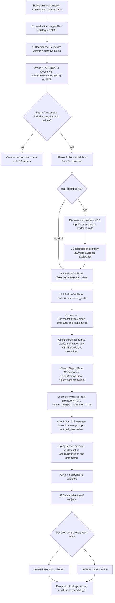

# Policy Validation Engine: Technical Design

**Updated**: 2026-11-11
**Status**: Scope aligned; Phase 1 implementation design complete, runtime validation pending
**Specification**: [Functional requirements](../../specs/002-policy-checker/spec.md)
**Decision**: [ADR-019: Stateless policy service and LLM flows](adr-019-file-based-policy-operations.md)
**Vocabulary**: [Glossary](glossary.md)
**Implementation plan**: [plan.md](../../specs/002-policy-checker/plan.md)

## Architecture and Boundaries

A stateless `PolicyService` class implements the exact MCP-ready interface (`create` / `policy_create`, `execute` /
`policy_execute`, and `read_trace`) using JSON-serializable Pydantic v2 request and result models. It has no control
repository, no `--root`, and no file-path selectors. The Vatuta client manages local YAML control files under
`policy.controls_directory` (or `--controls-dir`), provides a local filtering/projection tool with shared parameter
merging (`include_merged_parameters=True` by default), and exposes direct CLI subcommands (`create`, `execute`) plus a
guided 2-step prompt-driven policy check flow (`vatuta policy check "<prompt>"`). A stdio MCP transport (`policy
serve`) is deferred to the next increment.

## Operation Responsibilities

- **Stateless `PolicyService.create` (`policy_create`)**: Accept `policy_text`, optional `policy_id`, descriptive
  `construction_context`, optional `tags: list[str]`, and optional `trial_attempts`; decompose the policy into atomic
  rules and construct complete structured `ControlDefinition` objects sequentially with an incremental
  `SharedParameterCatalog`, bounded JSONata evidence discovery, mandatory `selection_tests` and `criterion_tests`, and
  configured live trials.
- **Stateless `PolicyService.execute` (`policy_execute`)**: Accept `controls: list[ControlDefinition]` inline (with
  unique `id`s), `parameters`, and `result_filter`; validate the complete request before acquisition, then execute
  independent controls and preserve results and visible errors by `control_id`. Source unavailability affects its
  control, not the entire validated request.
- **Client Filtering and Projection Tool (`ClientControlQuery`)**: Filter YAML files in `policy.controls_directory`
  (`--controls-dir`) by `ids`, `policy_ids`, `rule_ids`, `tags`, `evaluation_mode`, `evidence_server`, `evidence_tool`,
  `parameter_names`, `text_query`, `files`, or `glob`; project requested attributes (`projection`, including
  `["full"]`); and when `include_merged_parameters=True` (default) deterministically merge and validate shared
  parameters across matched controls without querying evidence or calling a model for parameter merging.
- **Client (`vatuta policy`)**: Read supported policy files into text, save `<id>.yaml` files, run direct `create` and
  `execute` commands, and execute the guided 2-step `vatuta policy check "<prompt>"` LLM pipeline.
- **Existing observability**: Save stage artifacts and model interactions with required redaction in the log directory.

`PolicyService` defines the MCP-ready contract using Pydantic v2 models with JSON-compatible types and `Field`
descriptions so wrapping it in `FastMCP` later requires no domain or schema changes. `vatuta policy serve` is excluded
from this increment.

## Step-by-Step Creation LLM Flow and Trials

0. **Step 0 — Pre-flight & Tool Catalog**:
   - Accept required nonempty `policy_text`, optional `policy_id` (defaulting to `invocation_id`), optional descriptive
     `construction_context` defaulting to empty, optional `tags: list[str]` defaulting to empty, and optional
     nonnegative `trial_attempts`.
   - Always populate the available tool catalog solely from local `policy.evidence_profiles` (`arguments_schema` and
     `contract_reference`). No MCP connection, server/container start, or `list_tools` is allowed until Phase A
     succeeds. When `trial_attempts == 0`, creation never accesses MCP; mandatory synthetic tests still run.
1. **Step 1 — Policy Decomposition (`PolicyDecompositionSignature`)**:
   - Decompose the policy into a complete list of atomic normative rules (`rule_id`, `description`, `excerpt`,
     `inferred_tags`), ignoring non-normative preamble/scope prose. If zero normative obligations are extracted, fail
     immediately with `NO_NORMATIVE_RULES` (`stage: "decomposition"`).
   - Assign each control its deterministic kebab-case `id`: `f"{policy_id}-{rule_id}"` (or `rule_id` directly when
     already prefixed with `f"{policy_id}-"`, deduplicated within the creation output).
   - **Decomposition criteria**:
     - If two conditions can fail independently and a user needs to know which one failed, they MUST be separate rules.
     - Ask: *"Would the policy author consider these two conditions two distinct violations?"* If yes, split them into
       separate rules.
2. **Step 2, Phase A — All-Rules Parameter & Evidence Sweep (`RuleEvidenceAndParametersSignature` across `r_1..r_N`)**:
   - Run Step 2.1 across all decomposed rules `r_1 ... r_N` first, passing the cumulative `SharedParameterCatalog`
     (`name`, `description`, `value_schema`, `construction_value`, `default`).
   - **`SharedParameterCatalog` Compatibility Rule**: Two parameters share the same parameter name **only** when their
     `value_schema`, `construction_value`, and `default` match. If any of those three differ despite similar semantics,
     it is effectively a distinct parameter: the constructor must either align to the catalog entry or use a distinct
     parameter name. Declarations already shared with another rule are immutable: adapt the current rule to the
     existing declaration or use a distinct name. Late declarations and retries cannot invalidate prior rules.
   - Keep tentative catalog changes local to the current attempt; publish only validated changes. Failed attempts
     discard their tentative additions and edits, leaving the accepted catalog unchanged for later rules and retries.
   - Deduce each rule's initial parameters (`construction_value` is optional when `trial_attempts == 0`), declaring only
     the minimum necessary parameters (`parameters: {}` when none are needed), optional explicit `default`s, and
     authorized MCP `server`, `tool`, and explicit argument bindings (`literal` or `parameter`).
   - **Collect-All `MISSING_CONSTRUCTION_CONTEXT` Gate**: When `trial_attempts > 0`, inspect all rules after Phase A; if
     any required parameter (`default` absent) lacks a `construction_value`, aggregate and return **all**
      `MISSING_CONSTRUCTION_CONTEXT` errors and affected `control_id`s across all rules at once before any MCP
      connection, `list_tools`, or server/container start.
3. **Step 2, Phase B — Per-Rule Deep Construction (`r_1 ... r_N`) with Fail-Fast**:
   - Execute Steps 2.2–2.5 sequentially per rule; abort immediately (**Fail-Fast**) as soon as any rule fails
     definitively after exhausting its configured attempts.
   - **2.2. Scalable In-Memory Source Exploration (`EvidenceDiscoverySignature` loop)**:
     - Only after Phase A succeeds and when `trial_attempts > 0`, start/connect to the required MCP servers and
       discover their tools. Validate declared bindings and resolved arguments against the discovered `inputSchema`
       before making evidence calls. Fetch declared evidence once in memory (cached per rule by
       `(server, tool, resolved_arguments)`) and verify completeness.
     - Allow the constructor to execute bounded exploratory JSONata projections evaluated over the root context
       `{"evidence": ..., "parameters": ...}`:
       - **Maximum queries**: configurable via `policy.discovery_max_queries` (default `5`, `>= 0`), with early loop
         termination as soon as the model sets `done=True`.
       - **Error / `missing` feedback**: syntax/runtime query errors or `missing` outcomes are returned as observations
         within the query budget so the constructor can refine its next query.
       - **Output truncation**: configurable via `policy.discovery_max_output_bytes` (default `4096` bytes, `> 0`),
         appending `[TRUNCATED]` if exceeded.
   - **2.3. Selection and Selection Unit Tests (`RuleSelectionSignature`)**:
     - May declare additional parameters (validated against `SharedParameterCatalog`) and generates
       `test_cases.selection_tests` (at least one populated `expected_subjects` case and one `NOT_APPLICABLE` case) plus
       the JSONata `selection` expression.
     - Normalize single-object JSONata selection results `{...}` to `[{...}]`, require non-whitespace `id` and
       `descriptive_id` (`len(s.strip()) > 0`), reject duplicate subject `id`s with `DUPLICATE_SUBJECT_ID`, resolve
       unit-test parameters with precedence `1. test_case.parameters` -> `2. default` -> `3. construction_value`, and
       validate `selection` immediately against all `selection_tests` (mandatory even when `trial_attempts == 0`) and
       against in-memory live evidence (when `trial_attempts > 0`).
   - **2.4. Criterion and Criterion Unit Tests (`RuleCriterionSignature`)**:
     - May declare additional parameters (validated against `SharedParameterCatalog`) and generates
       `test_cases.criterion_tests` (at least one `COMPLIANT` and one `NON_COMPLIANT` synthetic `subject`) plus
       `criterion` (preferring deterministic CEL; declaring `mode: llm` only with `condition` and
       `deterministic_insufficiency`).
     - Validate `criterion` immediately against all `criterion_tests` (mandatory even when `trial_attempts == 0`,
       evaluating with CEL for `mode: deterministic` and calling `SemanticCriterionSignature` on the LLM with
       `{{parameters.<name>}}` template substitution in `condition` for `mode: llm`) and against live trial subjects
       (when `trial_attempts > 0`).
   - **2.5. Full-Context Bounded Repair & Persistence**:
     - When `trial_attempts > 1` and a rule fails in Steps 2.2–2.4 (including a parameter newly created in 2.3/2.4
       lacking `default` and `construction_value`), re-execute from Step 2.1 carrying the full accumulated context and
       errors from all prior stages, reusing cached in-memory MCP evidence whenever `(server, tool, resolved_arguments)`
        are unchanged. Apply the same catalog immutability and attempt-local staging rules to every late declaration
        and retry; a repair cannot change declarations used by other rules.
     - Persist `test_cases` (`selection_tests` and `criterion_tests`) inside `ControlDefinition` so saved `<id>.yaml`
       files include reproducible unit tests.

An error-free live trial passes even if it detects violations or its selection is empty. For an empty live selection,
retain NOT_APPLICABLE and record `criterion_executed: false` on `creation_check` (while `criterion_tests` still verify
the criterion against synthetic subjects). Root null and evidence-completeness errors remain failures.

Before saving, the client checks the entire output set for target-path collisions. If any `<id>.yaml` already exists,
reject the save before writing any output and preserve existing files. Saving never overwrites an existing file, and
there is no overwrite option. This client check does not change the service's structured creation result.

## Guided 2-Step Check LLM Flow (`vatuta policy check "<prompt>"`)

When the user runs `vatuta policy check "<prompt>"`, the client executes a structured 2-step pipeline associated with a
single execution `invocation_id` trace (`vatuta://traces/policy/execution/{invocation_id}`). The client and service
share
an internal invocation context; the public `PolicyExecuteRequest` has no `invocation_id` field:

1. **Step 1 — Iterative Rule Selection (`PolicyCheckRuleSelectionSignature` / `check_rule_selection`)**:
   - The LLM inspects the user's prompt and iteratively queries `policy.controls_directory` (`--controls-dir`) using the
     local `ClientControlQuery` tool with lightweight projection (`projection=["id", "description", "tags", "source"]`,
     `include_merged_parameters=False`), bounded by configurable `policy.check_max_filter_queries` (default `3`, `>= 1`)
     and `policy.check_max_output_bytes` (default `4096` bytes, `> 0`, appending `[TRUNCATED]` if exceeded), exiting
     early when `done=True`.
   - Returns the selected list of `control_id`s. If `selected_control_ids` is empty (`[]`), fails immediately with
     `NO_CONTROLS_MATCHED` (exit code `2`) without calling `PolicyService.execute`.
2. **Deterministic Client Load & Parameter Merging**:
   - The client calls `ClientControlQuery(ids=selected_ids, projection=["full"], include_merged_parameters=True)` to
     load the full `ControlDefinition` objects and compute the conflict-checked `merged_parameters` deterministically.
3. **Step 2 — Parameter Deduction (`PolicyCheckParameterExtractionSignature` / `check_parameter_extraction`)**:
   - If `merged_parameters` is empty (`[]`), the Step 2 LLM call is skipped completely (`extracted_parameters = {}`).
     Otherwise, the signature receives the user's prompt and `merged_parameters` (`name`, `value_schema`, `required`,
     `default`, and per-control `description`s) and extracts the explicit JSON `parameters` map from the prompt without
     inventing missing values.
4. **Stateless Execution**:
   - The client calls `PolicyService.execute(controls=selected_controls, parameters=extracted_parameters,
      result_filter=...)` using that internal context and the same `invocation_id`.

Failures before `execute`, including selection, loading, merging, or parameter extraction failures, return the same
`{invocation_id, results: [], errors}` execution envelope and persist the check stages in that invocation's trace.
They do not create a second invocation or call `execute` merely to report failure.

## Trace Resource Contract

The client computes a trace resource URI from the invoked operation and returned `invocation_id`, using the templates
in the [operation contract](../../specs/002-policy-checker/contracts/operations.md#diagnostic-trace-resources).
Creation and execution introduce no additional trace field in their requests or responses. The same convention applies
to CLI and `PolicyService` invocation IDs; `policy_id` and local file paths are not used for URI resolution.

`PolicyService.read_trace(uri)` (which maps directly to future MCP `resources/read` and `resources/templates/list`)
reads sanitized InvocationTrace JSON (`application/json`) from `policy.trace_directory` (`logs/policy`). Reads use
existing permissions without model calls, source access, or reevaluation. Unknown, missing, deleted, malformed, or
inaccessible resources produce resource errors. A derived URI does not guarantee that a trace was persisted.

If trace persistence fails, retain the evaluation results and append a global `ErrorDetail` with
`code: "TRACE_WRITE_FAILED"` and `stage: "trace"` to the top-level `errors`; the CLI exits with code `1`. These errors
include invocation-level diagnostics as well as request errors. A trace failure does not change compliant findings into
subject errors, discard findings, or change control outcomes. The same rule applies to a check failure before `execute`:
retain its invocation ID, empty `results`, and existing errors, and append the trace diagnostic if its trace cannot
save.

## Parameter and Client Filtering Contract

Each `ControlDefinition` declares only the minimum necessary inputs required by its evidence, selection, or criterion
(`parameters: {}` when none are needed). Names, semantics, expected value schemas, construction values, and invocation
defaults are distinct fields in `ParameterDeclaration`.

- Same names identify the same shared input across selected controls. No per-control invocation override is needed.
- Construction values support trials; only explicitly declared defaults can fill omitted invocation inputs.
- Explicit invocation values override defaults. Without a usable supplied value or declared default, a required
  parameter is missing. Report its meaning and every affected `control_id`.
- Extra keys in `request.parameters` not declared by any supplied control are permitted (ignored at request level),
  passing each control only the subset of resolved parameters declared in its own `control.parameters`.
- During whole-request pre-flight (`Stage E0`), `PolicyService.execute` validates nonempty unique `control_id`s, shared
  parameter declaration compatibility, required parameter presence (`MISSING_PARAMETER`), and parameter `value_schema`
  conformance (`INVALID_PARAMETER_VALUE`), reporting all missing required inputs together and executing no controls on
  that failed request. Per-control evidence profile, allowlist, `arguments_schema`, `inputSchema`, and expression
  checks occur per control in `Stages E1–E3`.
- On the client side, the filtering and projection tool reads YAML files from `policy.controls_directory`
  (`--controls-dir`), combines distinct filter fields with logical **AND** and multi-value list fields (`ids`,
  `policy_ids`, `rule_ids`, `tags`, `parameter_names`, `files`) with logical **OR**, fails immediately with
  `INVALID_CONTROL_FILE` if any encountered YAML control file is malformed, projects requested fields (`projection`),
  and when `include_merged_parameters=True` (default) returns `merged_parameters` with deterministic conflict checking.

## Control Representation and Evaluation

Each control is represented in memory and over the service boundary as a `ControlDefinition` Pydantic model, and saved
on disk by the client as one YAML file (`<id>.yaml`) with `id`, `description`, `tags`, `source`, `parameters`,
`evidence`, `selection`, `criterion`, `test_cases`, and `creation_check`. Source credentials remain external.

- **Evidence**: Configured MCP server, tool, evidence identifier, and explicit arguments. Calls cannot use another
  evidence result or a control result as arguments. Source relationships belong in Selection. Within a single
  `PolicyService.execute` call, started `MCPServer` containers are kept alive across controls and valid responses are
  cached in memory by exact `(server, tool, resolved_arguments)`. If any evidence item in a control fails, that control
  fast-fails immediately without calling its remaining evidence items, selection, or criterion.
- **Selection**: JSONata transforms provider-neutral evidence into subjects. No result/empty collection is
  NOT_APPLICABLE; root null is ERROR. Valid subjects require non-empty, non-whitespace string `id` and `descriptive_id`
  (`len(s.strip()) > 0`); other fields may be null. Subjects with a unique valid `id` within the control's selection are
  evaluated by `criterion`, whereas invalid objects (`INVALID_SUBJECT`) and subjects sharing a duplicate `id`
  (`DUPLICATE_SUBJECT_ID`, with `subject_id` and `selection_index`) are not evaluated by `criterion`, are reported in
  `errors` without invented identifiers, and set the control's `outcome` to `"ERROR"`.
- **Criterion**: One declared deterministic CEL (`{subject, parameters}`) or singleton semantic LLM criterion (1 subject
  per call; no separate `parameters` dict sent to the LLM, with `{{parameters.<name>}}` template substitution in
  `condition`), reused independently for every valid unique-ID subject. True/false maps to COMPLIANT/NON_COMPLIANT;
  non-boolean or failed evaluations are ERROR. Never repair expressions, switch evaluation modes, or reinterpret policy
  text at runtime.
- **Test Cases (`test_cases`)**: Persisted `selection_tests` and `criterion_tests` unit test cases generated and
  verified during creation.

Semantic evaluation executes 1 subject per `SemanticCriterionSignature` call using only the rendered `condition`,
correlation reference (`subject_ref`), and that individual subject's inputs. Missing, conflicting, unexpected, or
unusable responses remain visible errors while independent evaluations continue.

## Evidence and Error Boundaries

Prefer MCP `structuredContent` when present. Otherwise accept exactly one text block containing a complete valid JSON
value. Do not extract fragments from prose/Markdown or combine multiple blocks. A tool-reported error remains an
acquisition error even if the payload contains parseable data.

Required evidence must be established as complete for the control's scope by the tool contract or response. Explicit
incompleteness or unknown completeness causes ERROR before Selection and Criterion, with no subject verdicts. Absence
of a warning alone does not establish completeness. No universal flag, automatic pagination, or retries are added;
within a single `PolicyService.execute` invocation, valid responses are cached in memory by exact `(server, tool,
resolved_arguments)`.

After pre-flight request validation (`Stage E0`), profile/allowlist/argument-scope errors, source access, decoding,
selection, and evaluation failures affect only their control (fast-failing that control's remaining stages); remaining
independent controls continue. This includes unavailable sources and semantic evaluator failures. Preserve already
obtained valid subject results; evaluate other valid unique-ID subjects despite individual criterion errors.

## Results and Diagnostics

Subject results carry technical/descriptive identifiers and their state. Each `ControlResult` includes `control_id`
(without `control_file`), `source` copied from the original `ControlDefinition.source`, and `parameters` containing only
that control's effective resolved runtime inputs. These values also appear in the trace. Construction metadata,
undeclared request keys, and inputs belonging only to other controls are excluded from the result's `parameters`.
Control outcomes are ERROR for execution or subject errors, or NOT_APPLICABLE for a successful empty selection.
Error-free nonempty evaluation has no aggregate COMPLIANT or NON_COMPLIANT state. Filtering all compliant subjects out
does not imply inapplicability.

`result_filter=all` returns all evaluated subject results (`COMPLIANT`, `NON_COMPLIANT`, and `ERROR`) in
`ControlResult.subjects`. `violations`, the default, returns only `NON_COMPLIANT` findings in `ControlResult.subjects`.
Both retain all control and subject errors in `ControlResult.errors`. The filter is invocation-level, not stored in
controls. No policy-wide percentage or replacement coverage formula is introduced.

Results and traces identify executed definitions, source provenance, resolved inputs, and subjects without policy
revision identifiers. Preserve stage directories, observable stage transitions and decisions, human-readable reusable
artifacts, durations, errors, and available model usage. Model samples distinguish creation from semantic evaluation and
retain prompts, returned raw/structured model outputs, available settings, and singleton subject mappings with required
credential/personal-data redaction. Private model reasoning and generated violation explanations are not required.

Traces remain in the configured log directory until explicitly deleted. This feature has no retention period setting,
automatic cleanup, or history-management operation. Interactive progress remains separate from logs and result output.

## Implementation Design Handoff

The [implementation plan](../../specs/002-policy-checker/plan.md) and
[research](../../specs/002-policy-checker/research.md) select the stateless `PolicyService` class, step-by-step
creation pipeline, client-side filtering/projection tool, 2-step `vatuta policy check "<prompt>"` pipeline, JSONata/CEL
bindings, and existing DSPy/provider integration. The [data model](../../specs/002-policy-checker/data-model.md) and
[operation contracts](../../specs/002-policy-checker/contracts/operations.md) specify `ControlDefinition` (with `tags`
and `test_cases`), parameter/default presence, client-side YAML saving and filtering, result envelopes, and errors.

[Design inputs](../../specs/002-policy-checker/design-inputs.md) tracks resolved decisions and implementation
qualification. [Quickstart](../../specs/002-policy-checker/quickstart.md) defines the minimal 2-scenario local E2E
acceptance check, while [demo-plan.md](../../specs/002-policy-checker/demo-plan.md) provides the complete standalone
configuration template and temporary GitHub/Jira blog showcase under `pocs/policy_demo/`, outside `src/` and CI.
Generate tasks with `/speckit-tasks`.
