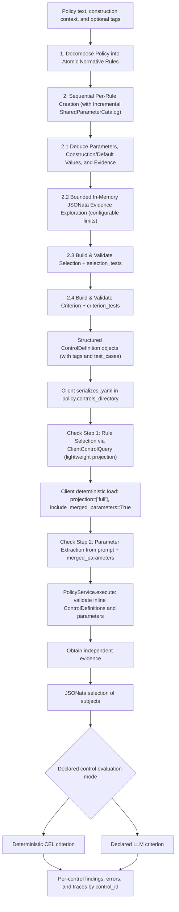

# Policy Validation Engine: Technical Design

**Updated**: 2026-11-04
**Status**: Scope aligned; Phase 1 implementation design complete, runtime validation pending
**Specification**: [Functional requirements](../../specs/002-policy-checker/spec.md)
**Decision**: [ADR-019: Stateless policy service and LLM flows](adr-019-file-based-policy-operations.md)
**Vocabulary**: [Glossary](glossary.md)
**Implementation plan**: [plan.md](../../specs/002-policy-checker/plan.md)

## Architecture and Boundaries

A stateless `PolicyService` class implements the exact MCP-ready interface (`create` / `policy_create`, `execute` /
`policy_execute`, and `read_trace`) using JSON-serializable Pydantic v2 request and result models. It has no control
repository, no `--root`, and no file-path selectors. The Vatuta client manages local YAML control files under
`policy.controls_directory` (or `--controls-dir`), provides a local filtering/projection tool with shared parameter
merging (`include_merged_parameters=True` by default), and exposes direct CLI subcommands (`create`, `execute`) plus a
guided 2-step prompt-driven policy check flow (`vatuta policy check "<prompt>"`). A stdio MCP transport (`policy
serve`) is deferred to the next increment.

## Operation Responsibilities

- **Stateless `PolicyService.create` (`policy_create`)**: Accept `policy_text`, optional `policy_id`, descriptive
  `construction_context`, optional `tags: list[str]`, and optional `trial_attempts`; decompose the policy into atomic
  rules and construct complete structured `ControlDefinition` objects sequentially with an incremental
  `SharedParameterCatalog`, bounded JSONata evidence discovery, mandatory `selection_tests` and `criterion_tests`, and
  configured live trials.
- **Stateless `PolicyService.execute` (`policy_execute`)**: Accept `controls: list[ControlDefinition]` inline (with
  unique `id`s), `parameters`, and `result_filter`; validate the complete request before acquisition, then execute
  independent controls and preserve results and visible errors by `control_id`. Source unavailability affects its
  control, not the entire validated request.
- **Client Filtering and Projection Tool (`ClientControlQuery`)**: Filter YAML files in `policy.controls_directory`
  (`--controls-dir`) by `ids`, `policy_ids`, `rule_ids`, `tags`, `evaluation_mode`, `evidence_server`, `evidence_tool`,
  `parameter_names`, `text_query`, `files`, or `glob`; project requested attributes (`projection`, including
  `["full"]`); and when `include_merged_parameters=True` (default) deterministically merge and validate shared
  parameters across matched controls without querying evidence or calling a model for parameter merging.
- **Client (`vatuta policy`)**: Read supported policy files into text, save `<id>.yaml` files, run direct `create` and
  `execute` commands, and execute the guided 2-step `vatuta policy check "<prompt>"` LLM pipeline.
- **Existing observability**: Save stage artifacts and model interactions with required redaction in the log directory.

`PolicyService` defines the MCP-ready contract using Pydantic v2 models with JSON-compatible types and `Field`
descriptions so wrapping it in `FastMCP` later requires no domain or schema changes. `vatuta policy serve` is excluded
from this increment.

## Step-by-Step Creation LLM Flow and Trials

1. **Step 1 — Policy Decomposition (`PolicyDecompositionSignature`)**:
   - Accept required nonempty `policy_text`, optional `policy_id`, optional descriptive `construction_context`
     defaulting to empty, optional `tags: list[str]` defaulting to empty, and optional nonnegative `trial_attempts`.
   - Decompose the policy into a complete list of atomic normative rules (`rule_id`, `description`, `excerpt`,
     `inferred_tags`).
   - **Decomposition criteria**:
     - If two conditions can fail independently and a user needs to know which one failed, they MUST be separate rules.
     - Ask: *"Would the policy author consider these two conditions two distinct violations?"* If yes, split them into
       separate rules.
2. **Step 2 — Sequential Per-Rule Creation with `SharedParameterCatalog`**:
   - Construct each rule one by one, passing the cumulative `SharedParameterCatalog` (`name`, `description`,
     `value_schema`, `construction_value`, `default`) from earlier rules of the same policy so conceptually identical
     parameters reuse the exact same parameter name and compatible `value_schema`.
   - **2.1. Parameters and Evidence (`RuleEvidenceAndParametersSignature`)**:
     - Deduce the rule's parameters (reusing names from `SharedParameterCatalog` where applicable), their
       `construction_value` (from policy/context), and optional explicit `default`.
     - Select the authorized MCP `server`, `tool`, and explicit argument bindings (`literal` or `parameter`).
   - **2.2. Scalable In-Memory Source Exploration (`EvidenceDiscoverySignature` loop)**:
     - When `trial_attempts > 0`, require all needed `construction_value` inputs (producing actionable
       `MISSING_CONSTRUCTION_CONTEXT` errors if missing) and fetch the declared evidence once in memory ( verifying
       completeness).
     - Rather than injecting raw evidence payloads into the LLM prompt, allow the constructor to execute bounded
       exploratory JSONata projections against the in-memory evidence (e.g., `$keys($)`, `prs.items[0]`,
       `$type(prs.items)`):
       - **Maximum queries**: configurable via `policy.discovery_max_queries` (default `5`, `>= 0`).
       - **Output truncation**: configurable via `policy.discovery_max_output_bytes` (default `4096` bytes, `> 0`),
         appending `[TRUNCATED]` if exceeded so the constructor can refine its JSONata projection.
   - **2.3. Selection and Selection Unit Tests (`RuleSelectionSignature`)**:
     - Generate `test_cases.selection_tests` (`mock_evidence` -> `expected_subjects` or `NOT_APPLICABLE`, including at
       least one populated subject case and one empty/`NOT_APPLICABLE` case) and the JSONata `selection` expression.
     - Validate `selection` immediately against all `selection_tests` (mandatory even when `trial_attempts == 0`) and,
       when `trial_attempts > 0`, against the live in-memory evidence to verify that the resulting `Subject` objects
       have nonempty string `id` and `descriptive_id` and match the expected structure.
   - **2.4. Criterion and Criterion Unit Tests (`RuleCriterionSignature`)**:
     - Using the verified `Subject` structure, generate `test_cases.criterion_tests` (synthetic `subject` objects with
       at least one `COMPLIANT` and one `NON_COMPLIANT` expected state) and the `criterion` (preferring deterministic
       CEL; declaring `mode: llm` only with `condition` and `deterministic_insufficiency`).
     - Validate `criterion` immediately against all `criterion_tests` (mandatory even when `trial_attempts == 0`) and,
       when `trial_attempts > 0` and live selection returned subjects, against the live trial subjects.
   - **2.5. Bounded Repair & Persistence**:
     - Preserve configured attempt limits (`trial_attempts`, default one; zero skips live trials while keeping
       structural, permission, and synthetic `selection_tests`/`criterion_tests` mandatory).
     - Persist `test_cases` (`selection_tests` and `criterion_tests`) inside `ControlDefinition` so saved `<id>.yaml`
       files include reproducible unit tests.

An error-free live trial passes even if it detects violations or its selection is empty. For an empty live selection,
retain NOT_APPLICABLE and record `criterion_executed: false` on `creation_check` (while `criterion_tests` still verify
the criterion against synthetic subjects). Root null and evidence-completeness errors remain failures.

## Guided 2-Step Check LLM Flow (`vatuta policy check "<prompt>"`)

When the user runs `vatuta policy check "<prompt>"`, the client executes a structured 2-step pipeline:

1. **Step 1 — Rule Selection (`PolicyCheckRuleSelectionSignature`)**:
   - The LLM inspects the user's prompt and queries `policy.controls_directory` (`--controls-dir`) using the local
     `ClientControlQuery` tool with lightweight projection (`projection=["id", "description", "tags", "source"]`,
     `include_merged_parameters=False`), bounded by configurable `policy.check_max_filter_queries` (default `3`, `>= 1`)
     and `policy.check_max_output_bytes` (default `4096` bytes, `> 0`, appending `[TRUNCATED]` if exceeded).
   - Returns the selected list of `control_id`s.
2. **Deterministic Client Load & Parameter Merging**:
   - The client calls `ClientControlQuery(ids=selected_ids, projection=["full"], include_merged_parameters=True)` to
     load the full `ControlDefinition` objects and compute the conflict-checked `merged_parameters` deterministically.
3. **Step 2 — Parameter Deduction (`PolicyCheckParameterExtractionSignature`)**:
   - If `merged_parameters` is nonempty, the signature receives the user's prompt and `merged_parameters` (`name`,
     `value_schema`, `required`, `default`, and per-control `description`s) and extracts the explicit JSON `parameters`
     map from the prompt without inventing missing values.
4. **Stateless Execution**:
   - The client calls `PolicyService.execute(controls=selected_controls, parameters=extracted_parameters,
     result_filter=...)`.

## Trace Resource Contract

The client computes a trace resource URI from the invoked operation and returned `invocation_id`, using the templates
in the [operation contract](../../specs/002-policy-checker/contracts/operations.md#diagnostic-trace-resources).
Creation and execution introduce no additional trace field in their requests or responses. The same convention applies
to CLI and `PolicyService` invocation IDs; `policy_id` and local file paths are not used for URI resolution.

`PolicyService.read_trace(uri)` (which maps directly to future MCP `resources/read` and `resources/templates/list`)
reads sanitized InvocationTrace JSON (`application/json`) from `policy.trace_directory` (`logs/policy`). Reads use
existing permissions without model calls, source access, or reevaluation. Unknown, missing, deleted, malformed, or
inaccessible resources produce resource errors. Trace-write failures remain visible through existing error semantics;
a derived URI does not guarantee that a trace was persisted.

## Parameter and Client Filtering Contract

Each `ControlDefinition` declares the inputs required by its evidence, selection, or criterion. Names, semantics,
expected value schemas, construction values, and invocation defaults are distinct fields in `ParameterDeclaration`.

- Same names identify the same shared input across selected controls. No per-control invocation override is needed.
- Construction values support trials; only explicitly declared defaults can fill omitted invocation inputs.
- Explicit invocation values override defaults. Without a usable supplied value or declared default, a required
  parameter is missing. Report its meaning and every affected `control_id`.
- Before any evidence call, `PolicyService.execute` validates the complete supplied `ControlDefinition` list (including
  unique `id`s) and resolved values against declarations and configured scope/permissions. It reports all missing
  required inputs together and executes no controls on that failed request.
- On the client side, the filtering and projection tool reads YAML files from `policy.controls_directory`
  (`--controls-dir`), filters by `ids`, `policy_ids`, `rule_ids`, `tags`, `evaluation_mode`, `evidence_server`,
  `evidence_tool`, `parameter_names`, `text_query`, `files`, or `glob`, projects requested fields (`projection`), and
  when `include_merged_parameters=True` (default) returns `merged_parameters` with deterministic conflict checking.

## Control Representation and Evaluation

Each control is represented in memory and over the service boundary as a `ControlDefinition` Pydantic model, and saved
on disk by the client as one YAML file (`<id>.yaml`) with `id`, `description`, `tags`, `source`, `parameters`,
`evidence`, `selection`, `criterion`, `test_cases`, and `creation_check`. Source credentials remain external.

- **Evidence**: Configured MCP server, tool, evidence identifier, and explicit arguments. Calls cannot use another
  evidence result or a control result as arguments. Source relationships belong in Selection.
- **Selection**: JSONata transforms provider-neutral evidence into subjects. No result/empty collection is
  NOT_APPLICABLE; root null is ERROR. Valid subjects require `id` and `descriptive_id`; other fields may be null.
  Evaluate valid subjects alongside malformed objects, reporting invalid objects without invented identifiers.
- **Criterion**: One declared deterministic CEL or semantic LLM criterion, reused independently for every subject.
  True/false maps to COMPLIANT/NON_COMPLIANT; non-boolean or failed evaluations are ERROR. Never repair expressions,
  switch evaluation modes, or reinterpret policy text at runtime.
- **Test Cases (`test_cases`)**: Persisted `selection_tests` and `criterion_tests` unit test cases generated and
  verified during creation.

Semantic batching remains optional under ADR-018. Judgments use only the criterion and the individual subject's inputs.
Preserve valid response mappings; missing, conflicting, unexpected, or unusable responses remain visible errors.
A failed batch errors its affected subjects while independent evaluations continue. No fixed batch size is required.

## Evidence and Error Boundaries

Prefer MCP `structuredContent` when present. Otherwise accept exactly one text block containing a complete valid JSON
value. Do not extract fragments from prose/Markdown or combine multiple blocks. A tool-reported error remains an
acquisition error even if the payload contains parseable data.

Required evidence must be established as complete for the control's scope by the tool contract or response. Explicit
incompleteness or unknown completeness causes ERROR before Selection and Criterion, with no subject verdicts. Absence
of a warning alone does not establish completeness. No universal flag, automatic pagination, retries, or cache is added.

After successful request validation, source access, decoding, selection, and evaluation failures affect their control;
remaining independent controls continue. This includes unavailable sources and semantic evaluator failures. Stop
Selection/Criterion after invalid evidence and stop Criterion after failed Selection. Preserve already obtained valid
subject results; evaluate other valid subjects despite individual criterion errors.

## Results and Diagnostics

Subject results carry technical/descriptive identifiers and their state. A `ControlResult` identifies the control by
`control_id` (without `control_file`) and has global ERROR for execution or subject errors, or NOT_APPLICABLE for a
successful empty selection. Error-free nonempty evaluation has no aggregate COMPLIANT or NON_COMPLIANT state. Filtering
all compliant subjects out does not imply inapplicability.

`result_filter=all` returns all subject results. `violations`, the default, returns NON_COMPLIANT findings. Both expose
errors separately or unmistakably distinguished. The filter is invocation-level, not stored in controls. No policy-wide
percentage or replacement coverage formula is introduced.

Results and traces identify executed definitions, source provenance, resolved inputs, and subjects without policy
revision identifiers. Preserve stage directories, human-readable reusable artifacts, durations, errors, and available
model usage. Model samples distinguish creation from semantic evaluation and retain prompts, responses, available
settings, and subject/batch mappings with required credential/personal-data redaction. No internal model reasoning
or generated violation explanation is required.

Traces remain in the configured log directory until explicitly deleted. This feature has no retention period setting,
automatic cleanup, or history-management operation. Interactive progress remains separate from logs and result output.

## Implementation Design Handoff

The [implementation plan](../../specs/002-policy-checker/plan.md) and
[research](../../specs/002-policy-checker/research.md) select the stateless `PolicyService` class, step-by-step
creation pipeline, client-side filtering/projection tool, 2-step `vatuta policy check "<prompt>"` pipeline, JSONata/CEL
bindings, and existing DSPy/provider integration. The [data model](../../specs/002-policy-checker/data-model.md) and
[operation contracts](../../specs/002-policy-checker/contracts/operations.md) specify `ControlDefinition` (with `tags`
and `test_cases`), parameter/default presence, client-side YAML saving and filtering, result envelopes, and errors.

[Design inputs](../../specs/002-policy-checker/design-inputs.md) tracks resolved decisions and implementation
qualification. [Quickstart](../../specs/002-policy-checker/quickstart.md) defines the minimal 2-scenario local E2E
acceptance check, while [demo-plan.md](../../specs/002-policy-checker/demo-plan.md) isolates the temporary GitHub/Jira
blog showcase under `pocs/policy_demo/` outside `src/` and CI. Generate tasks with `/speckit-tasks`.
