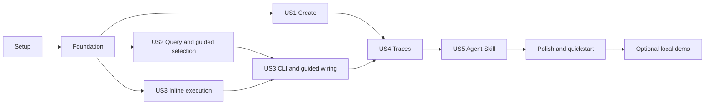

# Tasks: Policy Validation Engine

**Input**: [Specification](spec.md), [plan](plan.md), [research](research.md), and [data model](data-model.md)

**Contracts**: [Operations](contracts/operations.md) and [control format](contracts/control-format.md)

**Validation**: [Quickstart](quickstart.md). Write the unit and contract tests before each implementation group.
Use temporary files and fake LLM and MCP boundaries. The existing CI matrix runs on Python 3.12 and 3.13.

**Format**: `- [ ] T001 [P] [US1] Description with a repository-relative path`. `[P]` marks tasks in
the same group that can run in parallel once their prerequisites are ready. Story labels identify the owning phase.

## Phase 1: Setup (Shared Infrastructure)

**Purpose**: Prepare the package, approved dependencies, and deterministic fixtures.

- [ ] T001 [P] Update `pyproject.toml` and `poetry.lock` with the approved expression and schema dependencies.
  Pin `jsonata-python==0.7.1` and `cel-python==0.5.0`. Declare `jsonschema` and `google-re2` directly.
  Verify Python 3.12 and 3.13 compatibility and audit with `poetry run pip-audit`. Apply the dependency maturity rule.
- [ ] T002 [P] Initialize packages in `src/policy/__init__.py`, `src/policy/models/__init__.py`, and
  `src/policy/signatures/__init__.py` within the existing Poetry project.
- [ ] T003 [P] Add `tests/fixtures/policy/vatuta.yaml` and `tests/fixtures/policy/reference_evidence.json` for
  provider-neutral `reference_prs` and `reference_issues` tools. Use strict completeness and PRs 101, 102, and 103
  from `specs/002-policy-checker/contracts/reference-control.yaml`. Point tests at temporary controls and traces.

## Phase 2: Foundational (Blocking Prerequisites)

**Purpose**: Share validated contracts, expression evaluation, parameter resolution, and local invocation wiring.

### Tests

- [ ] T004 [P] Test strict Pydantic v2 schemas and reference control round trips in `tests/policy/test_contracts.py`.
  Cover required and unknown fields, enum values, embedded test cases, and self-contained MCP-ready schemas.
  Test required `subject_paths` on semantic controls. Reject empty lists, duplicate paths, root and malformed
  pointers. Accept escaped keys and explicit array indices.
- [ ] T005 [P] Test config compatibility and validation in `tests/policy/test_config.py`.
  Cover defaults and invalid limits or profiles using `tests/fixtures/policy/vatuta.yaml`. Load a pre-feature config.
- [ ] T006 [P] Test shared parameter resolution in `tests/policy/test_parameters.py`.
  Cover incompatible schemas, conflicting and mixed defaults, explicit overrides, and absent vs explicit `null`.
  Verify missing values report all affected controls.
- [ ] T007 [P] Test evaluator boundaries in `tests/policy/test_expressions.py`.
  Cover JSONata empty vs null, normalization, duplicate subject IDs, byte limits, and strict CEL booleans.
  Verify bounded evaluation and safe message rendering with escaped braces, missing paths, and explicit null.
- [ ] T008 [P] Test evidence acquisition with SDK-shaped fakes in `tests/policy/test_evidence.py`.
  Cover profile and schema guards, subprocess diagnostics without secrets, response precedence, strict completeness,
  cache keys, container reuse, and cleanup.
  Reject mutable image references and missing explicit tool allowlists before launch. Assert non-root execution,
  dropped capabilities, read-only root, CPU and memory limits, and default-deny networking unless the deployment
  explicitly approves access. Inject a secret into subprocess stderr and verify ordinary logs contain only safe status.
  Distinguish a tool error from a connection failure, disconnect, or response timeout.
  Reject MCP payloads containing non-string keys, non-finite numbers, or arbitrary Python objects. Verify
  script removal from projected HTML and preservation of the source evidence and plain-text values.
- [ ] T009 [P] Test semantic evaluation in `tests/policy/test_semantic.py`.
  Cover singleton calls, parameter substitution, strict booleans, and failed or mismatched `subject_ref` responses.
  Capture provider requests and verify instruction/data separation, HTML script removal, and projection.
  Cover pointer escapes, array indices, explicit nulls, and an absent target that prevents the model call.
  For an absent target, assert `MISSING_SUBJECT_PATH` at stage `criterion`, the affected `subject_id`, and a
  message containing the missing JSON Pointer. An explicit null must still reach the model.
- [ ] T010 [P] Test policy-only lazy startup and stderr routing in `tests/client/test_client.py`,
  `tests/llm/test_provider.py`, and `tests/test_logging_config.py`. Cover legacy provider preflight as a regression.

### Implementation

- [ ] T011 [P] Define `ParameterDeclaration` in `src/policy/models/parameter_declaration.py`.
  `required`: “Defaults to `true`. Set to `false` to allow omission when there is no default.”
  `value_schema`: “Self-contained JSON Schema 2020-12 (no network `$ref`).”
  `construction_value`: “Trial value for creation only (optional when `trial_attempts == 0`).
  Never used as execution default.” `default`: “Explicit execution default (presence tracked separately from `null`).”
- [ ] T012 [P] Define `ControlSource` in `src/policy/models/control_source.py` and evidence bindings in
  `src/policy/models/evidence_declaration.py` and `src/policy/models/argument_binding.py`.
  Preserve `{policy: str, rule: str, excerpt: str}` and
  `{name: str, server: str, tool: str, arguments: dict[str, ArgumentBinding]}`.
  “Each `ArgumentBinding` is either `{literal: <JSON>}` or `{parameter: <name>}` (whole-value binding, never both).”
- [ ] T013 [P] Define the two criterion models in `src/policy/models/deterministic_criterion.py` and
  `src/policy/models/semantic_criterion.py`. Use `{mode: "deterministic", expression: str, violation_message: str}`
  and `{mode: "llm", condition: str, deterministic_insufficiency: str, subject_paths: list[str],
  violation_message: str}`.
  Require the non-empty template in both modes. “Discriminated by `mode` (`"deterministic"` or `"llm"`).”
  “`subject_paths` is a required, non-empty list of distinct non-root RFC 6901 pointers relative to the subject.”
  Validate its syntax and include it in the semantic model.
- [ ] T014 [P] Define embedded test models in `src/policy/models/selection_test_case.py`,
  `src/policy/models/criterion_test_case.py`, and `src/policy/models/control_test_cases.py`.
  Use `mock_evidence: dict[str, Any]` (keyed by declared evidence `name`), `parameters: dict[str, Any] = {}`,
  `expected_outcome: Optional[Literal["NOT_APPLICABLE"]] = None`,
  `expected_subjects: Optional[list[dict[str, Any]]] = None`, and
  `expected_state: Literal["COMPLIANT", "NON_COMPLIANT"]`.
  “Exactly one of `expected_outcome` or `expected_subjects` must be set.”
  “Every subject in `expected_subjects` must have non-whitespace string `id` and `descriptive_id` (`len(s.strip()) >
  0`) and unique `id`s (duplicate `id`s fail with `DUPLICATE_SUBJECT_ID`).”
  Criterion tests require `subject: dict[str, Any]` (non-whitespace `id` and `descriptive_id`).
  “`ControlTestCases` requires at least 1 populated and 1 `NOT_APPLICABLE` `selection_tests` case, and at least 1
  `COMPLIANT` and 1 `NON_COMPLIANT` `criterion_tests` case.”
- [ ] T015 Assemble `ControlDefinition` in `src/policy/models/control_definition.py` with
  `src/policy/models/creation_check.py` (FR-002, FR-034, FR-041, FR-043, FR-046).
  `id`: “Deterministic kebab-case slug `f"{policy_id}-{rule_id}"` (or `rule_id` if already prefixed). Unique per call.”
  `tags`: “Deduplicated non-empty tags (combines LLM-inferred tags + caller request `tags`).”
  `parameters`: “Map of parameter name -> declaration (`{}` allowed when no inputs needed).”
  `evidence`: “Non-empty list of independent MCP tool calls with unique `name`s in the control.”
  `selection`: “JSONata expression evaluated over `{evidence, parameters}`.”
  “Mandatory embedded unit tests (`selection_tests` and `criterion_tests`).”
  Use `trial: "skipped" | "passed"`, `criterion_executed: bool`, and
  optional `outcome: "NOT_APPLICABLE"` for `creation_check`.
- [ ] T016 Define the shared error and per-call invocation records in `src/policy/models/error_detail.py` and
  `src/policy/invocation_context.py`. Use required `code`, `stage`, `message` and optional `control_id`,
  `parameter`, `subject_id`, `descriptive_id`, and `selection_index: int`. Client write failures also have
  “`unsaved_paths: list[str]` relative to the output directory.” Keep engine-assigned IDs and stage records in
  the internal context, outside public requests.
- [ ] T017 Define execution contracts in `src/policy/models/policy_execute_request.py`,
  `src/policy/models/policy_execute_result.py`, `src/policy/models/control_result.py`, and
  `src/policy/models/subject_result.py` (FR-004, FR-007, FR-009, FR-017, FR-021).
  Use non-empty unique inline controls, `parameters: dict[str, Any] = {}`, and
  `result_filter: Literal["violations", "all"] = "violations"`.
  Return `{invocation_id: str, results: list[ControlResult], errors: list[ErrorDetail]}`.
  Use `evaluation_mode: Literal["deterministic", "llm"]` and `outcome?: Literal["ERROR", "NOT_APPLICABLE"]`.
  “Always includes `source` and effective per-control `parameters` (even on `ERROR` or `NOT_APPLICABLE`).”
  Subject states are `COMPLIANT`, `NON_COMPLIANT`, and `ERROR`.
  “Include the rendered `violation_message` only for `NON_COMPLIANT`.”
  Apply `extra='forbid'`, `Field(description=...)`, JSON types, and one model class per file throughout.
- [ ] T018 Define trusted `<server>.<tool>` profiles in `src/policy/models/evidence_profile.py`
  (FR-005, FR-008, FR-013). Include `contract_reference: str` and
  `arguments_schema: dict[str, Any]` (JSON Schema restricting allowed arguments).
  Use `complete_when: str` (JSONata boolean expression over `{data, arguments, response}`),
  `trace_redact_paths: list[str]` (JSON Pointers to redact), and
  `trace_safe_text_paths: list[str]` (non-sensitive text paths allowed in traces).
  Validate both trace path lists as RFC 6901 JSON Pointers. Support explicit array indices and standard
  escapes. Treat `*` as a literal key and reject malformed pointer syntax before acquiring evidence.
- [ ] T019 Add `PolicyConfig` in `src/policy/config.py`, an optional section in `src/models/config.py`, and
  its generic example in `config/vatuta.yaml.example`. Keep these defaults:
  `controls_directory: str = "data/controls"`, `trace_directory: str = "logs/policy"`,
  `creation_backend: Optional[str] = None` (defaults to generator binding),
  `evaluation_backend: Optional[str] = None` (defaults to generator binding),
  `trial_attempts: int = 1`, `discovery_max_queries: int = 5`, `discovery_max_output_bytes: int = 4096`,
  `check_max_filter_queries: int = 3`, `check_max_output_bytes: int = 4096`, and
  `evidence_profiles: dict[str, EvidenceProfile] = {}`. Validate nonnegative trial/discovery counts,
  a positive filter query count, and positive byte limits.
- [ ] T020 Implement `MergedParameter` in `src/policy/models/merged_parameter.py` and the common resolver in
  `src/policy/parameters.py` (FR-040). Return `{name, value_schema, required, default?, controls}`.
  Match normalized schemas and all declared defaults, reporting `PARAMETER_CONFLICT` on incompatibility.
  “A declared `null` is a present value, not an absent default.”
  Use “`1. request.parameters[name]` -> `2. eligible merged default`” with no type coercion or trial values.
  Validate declared defaults and explicit values against the schema. Reject conflicts even with an explicit override.
  If any declaration requires the parameter without a default, set `required: true`, omit `default`, and
  require an explicit value. “Leave an omitted optional parameter with no eligible default absent from the resolved
  parameter map.” Report all missing inputs and affected IDs with `MISSING_PARAMETER`. Use `INVALID_PARAMETER_VALUE`
  on a schema failure and scope resolved values to each control.
- [ ] T021 Implement bounded JSONata and CEL adapters in `src/policy/expressions.py` (FR-006, FR-015, FR-045).
  Preserve the existence envelope, object-to-list normalization, and strict booleans. Use the research R2 bounds
  and RE2 guard. Compile CEL once per control. Require non-empty, non-whitespace string `id` and `descriptive_id`.
  Report invalid or duplicate subjects with their selection indices for the shared creation and execution paths.
- [ ] T022 Implement the shared violation message renderer in `src/policy/expressions.py` (FR-019, FR-051).
  Resolve direct or nested subject fields and declared parameter paths. Support literal braces and render null
  as `null`. Reject missing or invalid fields, calls, Python attribute access, and whitespace-only results.
- [ ] T023 Implement the common read-only evidence path in `src/policy/evidence.py`, reusing
  `src/mcp/server.py` and its tool allowlist (FR-005, FR-008, FR-013). Validate local profiles and allowed bindings
  before launch and the live schema before each call. Omit absent optional argument bindings and keep explicit
  nulls. Check `isError`, prefer `structuredContent`, then accept one valid JSON text block.
  “Only strict boolean `True` from `complete_when` proves completeness (`False` -> incomplete `ERROR`; other/missing ->
  unknown completeness `ERROR`).” Reuse valid responses by exact `(server, tool, resolved_arguments)` and close
  invocation-owned resources. Use the approved container safeguards and send only status diagnostics to ordinary logs.
  Validate digest pinning, an explicit tool allowlist, non-root execution, dropped capabilities, read-only root,
  resource limits, and default-deny networking before launch. Allow network access only with deployment approval.
  Use a policy-specific stderr sink that emits safe status diagnostics. Surface connection failure, disconnect, and
  timeout as server unavailability. Preserve tool errors from a responding server as control-level failures.
  Validate structured and text response values as JSON, including string keys and finite numbers. Sanitize
  copies of projected external HTML by removing scripts and their contents. Preserve plain text as data and the
  original validated evidence for deterministic evaluation.
- [ ] T024 Implement `src/policy/semantic.py` and `src/policy/signatures/semantic_criterion.py`
  (FR-035, FR-036). Substitute `{{parameters.<name>}}` in `condition`. Send
  `{condition, subject_ref, subject}` and require `{subject_ref, verdict: bool}` for one subject.
  Use the research R4 DSPy adapter context and reject missing, ambiguous, mismatched, or non-boolean output.
  Resolve `subject_paths` to a pointer-to-value map. Keep nulls and return subject-level `ERROR` without
  an LLM call on an absent target. Sanitize projected HTML. Pass the condition and projected subject as input data.
  Use this flow for synthetic tests, live trials, and execution. Render violations from the original subject.
  For an absent target, produce an `ErrorDetail` with `code: "MISSING_SUBJECT_PATH"`, `stage: "criterion"`,
  the affected `subject_id`, and a message such as `Required subject path '/title' is missing` (FR-035).
- [ ] T025 Add selected-backend validation in `src/llm/provider.py` and policy stderr diagnostics via
  `src/utils/logging_config.py` and `config/logging.yaml` (FR-022, FR-023). Preserve default behavior for
  existing callers. Use central logging, component and stage labels, and lazy logging arguments.
  Ensure the provider request preserves engine-authored instructions and separate structured data for
  authoring, guided checks, and semantic calls.
- [ ] T026 Register the policy CLI group in `src/client/client.py` and establish shared client output and exit code
  handling in `src/client/policy.py` (FR-009, FR-022). Only the policy group bypasses eager provider validation.
  Allow query and deterministic execution to run without RAG, Qdrant, or LLM initialization.
  Allocate one unique invocation context at each CLI command entry, before validating operation inputs.
  Pass it to shared handlers and service calls. Reuse a context supplied by a delegating Skill script.

**Checkpoint**: Shared models, config, evaluators, and client wiring are ready for the story phases.

## Phase 3: User Story 1 - Create Controls Step by Step from a Policy (Priority: P1)

**Goal**: Generate one verified YAML control per atomic policy rule.

**Independent test**: Give `create` a multi-rule policy, context, and tags. Use fake model responses and MCP evidence.
Check the saved controls and their synthetic tests. Exercise attempts `0`, `1`, and `>1`, rejection before any MCP
call for missing trial inputs, and retention of complete files when a later write fails (SC-001, SC-002).

### Tests for User Story 1

- [ ] T027 [P] [US1] Test the creation pipeline in `tests/policy/test_creation.py`. Cover atomic splitting,
  context authority, immutable shared declarations, bounded discovery, missing context, unsupported obligations,
  synthetic tests and message rendering at every trial setting, and whole-call failure.
  Simulate required MCP server unavailability during discovery and live trials. Assert
  `MCP_SERVER_UNAVAILABLE`, `controls: []`, and no repair or further evidence calls (FR-018, FR-026).
  Capture authoring requests for policy text and sanitized evidence in separate data fields. Verify
  provenance excerpts and semantic projections in synthetic and live trials. Inject trace write failures after
  successful and failed generation. Assert the same ID, `controls: []`, and global `TRACE_WRITE_FAILED` while
  retaining any earlier error (FR-010, SC-009).
- [ ] T028 [P] [US1] Test write prechecks and a mid-batch failure in `tests/policy/test_files.py`. Assert
  `CONTROL_FILE_EXISTS` writes nothing and `CONTROL_FILE_WRITE_FAILED` lists exactly the unsaved paths.
- [ ] T029 [P] [US1] Test the creation contract in `tests/policy/test_contracts.py`.
  Verify the request and full-or-empty response against `specs/002-policy-checker/contracts/operations.md`.
  Verify trace-write failure returns the original invocation ID, empty controls, and both errors when present.
- [ ] T030 [P] [US1] Test CLI authoring from inline text and UTF-8 policy files in `tests/client/test_policy.py`.
  Cover invalid formats, flag forwarding, nested output directories, and JSON exit and error parity.
  Verify required MCP server unavailability returns exit code `1` and writes no generated YAML (FR-018).
  Verify a failed creation trace write after successful validation exits `1` and leaves the YAML output untouched.

### Implementation for User Story 1

- [ ] T031 [US1] Define the create request in `src/policy/models/policy_create_request.py` (FR-001, FR-002).
  Require non-empty `policy_text: str`, accept `policy_id?: str`, `construction_context: str = ""`,
  `tags: list[str] = []`, and `trial_attempts?: int` with `>= 0` when set.
  Return `{invocation_id: str, controls: list[ControlDefinition], errors: list[ErrorDetail]}` from
  `src/policy/models/policy_create_result.py`.
- [ ] T032 [US1] Define the atomic authoring signatures in `src/policy/signatures/policy_decomposition.py`,
  `src/policy/signatures/rule_evidence_and_parameters.py`, `src/policy/signatures/evidence_discovery.py`,
  `src/policy/signatures/rule_selection.py`, and `src/policy/signatures/rule_criterion.py`.
  Use the approved structured outputs and the per-call DSPy adapter context in research R4.
  Keep engine instructions in DSPy signatures and policy text, rule context, tool metadata, and projected
  evidence in stage-specific data fields.
- [ ] T033 [US1] Implement Steps 0 and 1 in `src/policy/creation.py` (FR-001, FR-032, FR-041, FR-043, FR-044).
  Use local profiles. Default `policy_id` to `invocation_id`. Split independent obligations, retain policy
  provenance, merge and deduplicate tags, and assign deterministic unique slugs. Fail with `NO_NORMATIVE_RULES`
  at `decomposition` when there are no obligations.
  Verify each generated provenance excerpt occurs in the submitted policy before accepting the rule (FR-032).
- [ ] T034 [US1] Implement the all-rule Phase A sweep in `src/policy/creation.py` (FR-038).
  “Pass `SharedParameterCatalog` (`dict[str, ParameterDeclaration]`) sequentially across rules `r_1..r_N`.”
  Reuse names only when `value_schema`, `construction_value`, and `default` match. Keep accepted entries
  immutable across Phase B and retries. Validate permissions locally and fail on unrepresentable obligations.
  Keep sample values as `construction_value`. Collect all `MISSING_CONSTRUCTION_CONTEXT` errors and control IDs
  before MCP when trials are enabled and required inputs lack both a default and a construction value.
- [ ] T035 [US1] Implement live discovery in Step 2.2 in `src/policy/creation.py` (FR-026, FR-045).
  Fetch and validate evidence only when `trial_attempts > 0`. Pass bounded JSONata projections to the model
  with query errors or missing values as observations and `[TRUNCATED]` within the byte budget.
  Apply `policy.discovery_max_queries` and `policy.discovery_max_output_bytes` and stop early on `done=True`.
  Stop discovery immediately on required MCP server unavailability and report `MCP_SERVER_UNAVAILABLE` (FR-018).
  Sanitize external HTML in projected values and pass only bounded evidence needed for discovery.
- [ ] T036 [US1] Implement Steps 2.3 and 2.4 in `src/policy/creation.py` (FR-003, FR-034, FR-046, FR-051).
  “Single selected JSON object `{...}` normalizes to `[{...}]` before comparison.”
  Generate, run, and save both sets of tests with “`1. test_case.parameters` -> `2. parameter.default` ->
  `3. parameter.construction_value`”. Prefer CEL and require a justification for `llm`. Render and validate
  the explanation and remediation for every synthetic and live `NON_COMPLIANT` subject.
  Run the mandatory synthetic tests even with zero live trials.
  Generate and persist `subject_paths` for each semantic criterion and verify them in criterion tests
  using the runtime projection (FR-035).
- [ ] T037 [US1] Complete Step 2.5 in `src/policy/creation.py` and expose `create` from `src/policy/service.py`
  (FR-002, FR-009, FR-026). Zero runs synthetic tests with no MCP and sets `trial: "skipped"`. One allows one
  live attempt. More than one shares the retry budget for synthetic and live failures from Step 2.1 with full
  context and unchanged evidence reuse. An error-free `NOT_APPLICABLE` or `NON_COMPLIANT` live trial passes.
  On exhaustion return `controls: []` with errors. The service receives inline input and manages no rule files.
  Stop before retrying if a required server becomes unavailable during a trial. Return `controls: []` with
  a global `MCP_SERVER_UNAVAILABLE` error (FR-018). Reuse the caller's context or create one for a direct service call.
  Define `InvocationTrace` in `src/policy/models/invocation_trace.py` and persist the sanitized creation trace
  from `src/policy/trace.py` (FR-010, FR-024, FR-027, SC-009). Capture stage and prompt records for success and
  failure. Save before returning controls. Apply T018 trace paths. On write failure preserve the ID and earlier
  errors, append global `TRACE_WRITE_FAILED`, and return `controls: []`.
- [ ] T038 [US1] Write one complete `<id>.yaml` per control in `src/policy/files.py` (FR-041).
  Use the configured or chosen output directory and create missing subfolders. Precheck containment and all
  collisions before writing, preserve existing files, and stop on a write failure. Keep completed files and
  report failed and unattempted paths with `CONTROL_FILE_WRITE_FAILED` at `client_persistence` (Exit `1`).
  Return paths relative to the output directory and leave no partial target file.
  Keep collision protection and avoid shared YAML file locks (FR-041).
- [ ] T039 [US1] Route `vatuta policy create` through the shared handler in `src/client/policy.py`
  (FR-001, FR-009, FR-041). Validate plain text or Markdown files and UTF-8 before any LLM call. Forward
  policy ID, context, tags, and trial attempts. Call the YAML writer only after successful service creation.
  Write YAML after the service returns validated controls with a saved trace. On `TRACE_WRITE_FAILED`,
  emit the service errors and exit `1` before writing YAML (FR-010, SC-009).

**Checkpoint**: The create command saves a sanitized construction trace before writing verified YAML controls.
For the MVP, force a trace write failure and verify an error response and an untouched YAML directory.

## Phase 4: User Story 2 - Search Controls, Get Merged Parameters, and Run Guided Check (Priority: P1)

**Goal**: Search a YAML directory, discover required parameters, and prepare a verified guided execution.

**Independent test**: Use a nested fixture with one broken file and two controls that share an ID. Exercise selectors,
projections, and parameter merging without external calls. Use a fake model and execution callable to check
confirmation, path and ID verification, and parameter extraction (SC-003, SC-004, SC-010).

### Tests for User Story 2

- [ ] T040 [P] [US2] Test scoped YAML queries in `tests/policy/test_files.py`. Cover the `files` and `glob`
  intersection, content filters, unsafe paths, matched duplicate IDs, and opt-out of parameter merging.
  Compare broken files inside and outside the path scope.
- [ ] T041 [P] [US2] Test guided selection and extraction in `tests/policy/test_agent.py` with a fake executor.
  Cover last-query confirmation, budget exhaustion, confirmed empty selection,
  unseen pairs, changed IDs, same-ID variants, and zero extraction or evidence calls on selection failure.
  Assert that internal queries, parameter extraction, and execution share the guided invocation ID.
  Capture provider requests and verify metadata stays in data fields, eligibility follows pairs actually
  delivered to the model, and extraction sees only confirmed declarations.
- [ ] T042 [P] [US2] Test query and guided selection contracts in `tests/policy/test_contracts.py`.
  Verify projected and full results against `specs/002-policy-checker/contracts/operations.md`.
  Check that an explicit null default survives serialization and an absent value is omitted.
- [ ] T043 [P] [US2] Test JSON query wiring, selector flags, and local-only startup in `tests/client/test_policy.py`.
  Assert output and exit codes for invalid, empty, and successful selections.
  Verify distinct IDs for independent `query` calls and an ID in stderr on success and validation failure.
  Assert that stdout still matches `ClientControlQueryResult`.

### Implementation for User Story 2

- [ ] T044 [US2] Define query models in `src/policy/models/client_control_query.py` (FR-039).
  Use `Optional[list[str]]` for `ids`, `policy_ids`, `rule_ids`, `tags`, `parameter_names`, and `files`.
  Use `Optional[Literal["deterministic", "llm"]]` for `evaluation_mode` and
  `Optional[str]` for `evidence_server`, `evidence_tool`, `text_query`, and `glob`.
  Projection defaults to `["id", "description", "tags", "source", "parameters"]` and accepts `["full"]`.
  “Always includes relative `file` in projected summary dicts.”
  `include_merged_parameters: bool` defaults to `True`. In `src/policy/models/client_control_query_result.py`,
  return projected or full controls with errors and omit `merged_parameters` when disabled.
- [ ] T045 [US2] Implement safe scoped YAML loading in `src/policy/files.py` (FR-039, FR-042, FR-050).
  `files`: “Specific `.yaml` file paths relative to or contained in `controls_directory` (OR).”
  `glob`: “Glob pattern (including `**`) matching relative paths (`team-a/**/*.yaml`) or bare filenames
  (`*github*.yaml`).”
  Intersect `files` and `glob` before reads, or use all contained `.yaml` files if neither is supplied.
  Reject traversal and external symlinks.
  “Safe YAML loader rejects duplicate keys, multiple documents, unsafe tags, and non-JSON types.”
  Also reject recursive aliases and unknown fields. Malformed, unreadable, or invalid candidates fail before
  ID or metadata filtering with `INVALID_CONTROL_FILE` (Exit `2`).
- [ ] T046 [US2] Complete filtering, projection, and merge in `src/policy/files.py` using `src/policy/parameters.py`
  (FR-012, FR-039, FR-040, FR-042). Apply `ids`, policy/rule, tag, mode, server/tool, parameter, and text filters.
  “Distinct filter fields combine with **AND**; list values combine with **OR**.”
  `ids`: “Exact `control.id` or glob/wildcard patterns on `control.id` (e.g., `change-mgmt-*`) (OR).”
  `policy_ids` and `rule_ids`: “Match `source.policy` (OR).” and “Match `source.rule` (OR).”
  `tags`: “Match controls containing any listed tag (OR).” `evaluation_mode`: “Match `criterion.mode`.”
  `evidence_server` and `evidence_tool`: “Match `evidence[].server`.” and “Match `evidence[].tool`.”
  `parameter_names`: “Match controls declaring any listed parameter name (OR).”
  `text_query`: “Case-insensitive substring match in `description` or `source.excerpt`.” Return `NO_CONTROLS_MATCHED` or
  `DUPLICATE_CONTROL_ID` (Exit `2`) for empty or duplicate matched selections.
- [ ] T047 [US2] Define selection and extraction signatures in `src/policy/signatures/policy_check_rule_selection.py`
  and `src/policy/signatures/policy_check_parameter_extraction.py` (FR-047).
  Require confirmation `done=True` with `selected_controls: list[{file: str, id: str}]`. Use an engine-owned
  invocation context and only accept explicit parameter values extracted from the prompt.
  Keep user prompts, candidate metadata, and confirmed declarations in separate data fields for each stage.
- [ ] T048 [US2] Implement the guided search and reload in `src/policy/agent.py` (FR-047).
  Use lightweight projections with relative `file`, no merge, and the configured query and byte limits.
  Record the complete `(file, id)` pairs shown to the model. A model may confirm after the last result.
  Unconfirmed exhaustion returns `CONTROL_SELECTION_INCOMPLETE` (Exit `1`). Confirmed empty returns
  `NO_CONTROLS_MATCHED` (Exit `2`). Reload only confirmed paths and recheck containment and IDs before merging.
  Reject an unseen pair or changed ID with `INVALID_CONTROL_SELECTION` (Exit `1`), and a selected duplicate ID
  with `DUPLICATE_CONTROL_ID` (Exit `2`).
  Project metadata after safe YAML loading and `ControlDefinition` validation. Track exact pairs delivered
  after truncation and revalidate confirmed files before dispatch.
- [ ] T049 [US2] Merge verified controls and complete parameter extraction in `src/policy/agent.py` (FR-047).
  Skip extraction when `merged_parameters == []`. Pass inline controls and explicit values to the execution
  callable with the same internal `invocation_id`. On pre-execution failure, preserve stage records and return
  empty results without calling execution. Test US2 with a fake execution callable until US3 provides the real one.
  Pass only the user prompt and merged declarations as data fields. Validate extracted values against their schemas.
- [ ] T050 [US2] Add `vatuta policy query` and reusable check handler wiring in `src/client/policy.py`
  (FR-009, FR-039, FR-047, FR-050). Expose the shared path, ID, and metadata selectors, projections, and merge flags.
  Use the query and error contracts so the Agent Skill can call the same handler later.
  Record standalone query diagnostics with the invocation ID on success and failure, keeping its JSON schema.
  Pass the existing guided context through internal queries, parameter extraction, and execution.

**Checkpoint**: Query works over local YAML. Verify guided selection, extraction, and dispatch with a fake executor.

## Phase 5: User Story 3 - Execute Supplied Controls and Inspect Results (Priority: P1)

**Goal**: Evaluate inline or client-selected controls, isolate failures, and return actionable subject results.

**Independent test**: Execute reference YAML controls as inline objects with fixed MCP and LLM responses.
Verify PRs 101/102/103, finding messages, filter behavior, isolated failures, and no evidence calls for
invalid or missing required parameters (SC-004 through SC-008, SC-010).

### Tests for User Story 3

- [ ] T051 [P] [US3] Test E0 through E4 in `tests/policy/test_execution.py` with SDK-shaped fakes. Cover
  zero evidence calls on input errors, partial error isolation, evidence reuse, empty and null selections,
  duplicate subjects, no deterministic-to-LLM fallback, and identical valid deterministic results.
  Simulate connection failure, disconnect, and timeout after one control completes. Assert completed results
  under both filters, a global `MCP_SERVER_UNAVAILABLE`, and zero subsequent evidence or criterion calls.
  Cover empty results before any control completes and continuation after a tool error from a responding server.
  Verify absent projection paths fail only affected subjects with zero model calls for those subjects.
  Check that violation rendering still uses the original validated subject.
  Run the missing-path case with `violations` and `all`. Assert both return the same `ControlResult.errors`
  diagnostic with code `MISSING_SUBJECT_PATH`, stage `criterion`, subject ID, and missing pointer. The affected
  subject appears as `ERROR` under `all` and is absent under `violations`. Verify other subjects still run.
- [ ] T052 [P] [US3] Test `execute` CLI wiring in `tests/client/test_policy.py`.
  Cover inline and `@file.json` parameters, filters, lazy startup, and
  `test_missing_parameters_rejects_before_external_calls`.
  Verify inline `execute` and guided `check` return exit code `1` and completed results on required MCP outage.
- [ ] T053 [P] [US3] Test the execution response contract in `tests/policy/test_contracts.py`. Check provenance
  and effective values under both filters. Check subject error details and absent outcome or message fields.

### Implementation for User Story 3

- [ ] T054 [US3] Implement E0 with the shared resolver in `src/policy/execution.py` (FR-012, FR-014, FR-040, FR-042).
  Reject an empty control list, duplicate control IDs, conflicting declarations, missing required parameters, and
  schema violations before any evidence or model call. Return all affected controls for missing parameters.
- [ ] T055 [US3] Implement E1 evidence and E2 subject selection in `src/policy/execution.py`
  (FR-004, FR-005, FR-008, FR-013, FR-014, FR-015, FR-018). Share the MCP session and evidence cache per invocation.
  Stop a control on incomplete or invalid evidence. Missing or empty selection is `NOT_APPLICABLE`. Root null
  or a scalar is `ERROR`. Skip invalid objects and duplicate IDs with `INVALID_SUBJECT` or
  `DUPLICATE_SUBJECT_ID` and keep evaluating valid unique subjects.
  On required MCP server unavailability, stop the invocation. Pass completed results and a top-level
  `MCP_SERVER_UNAVAILABLE` at stage `evidence` to E4. Identify the server in the error message (FR-018, SC-006).
- [ ] T056 [US3] Implement E3 criteria and E4 response filtering in `src/policy/execution.py`
  (FR-006, FR-007, FR-017, FR-018, FR-019, FR-021, FR-035, FR-036, FR-051). Evaluate CEL or the declared
  singleton LLM criterion. Render `violation_message` only on `NON_COMPLIANT`. Report
  `VIOLATION_MESSAGE_RENDER_ERROR` for that subject and keep other results. Include provenance and effective
  parameters even on failure. Keep all errors under either filter. Omit `outcome` on clean non-empty results.
  Add the semantic `MISSING_SUBJECT_PATH` diagnostic to `ControlResult.errors` before filtering subject
  results. Preserve it under both `violations` and `all` (FR-021, FR-035).
- [ ] T057 [US3] Expose inline `PolicyService.execute` in `src/policy/service.py` (FR-004, FR-009, FR-012) with
  its own invocation context for direct calls and the supplied internal context for guided calls.
  Keep rule file selection and policy text outside the service.
  Reuse the caller's context or allocate one for a direct service call before validating its input.
- [ ] T058 [US3] Wire `vatuta policy execute` and guided `check` in `src/client/policy.py`
  (FR-009, FR-012, FR-021, FR-047, FR-050). Reuse the query selectors, inline execution, and JSON result mapping.
  Accept `--parameters` as JSON or `@file.json` and pass the requested result filter.

**Checkpoint**: Direct and guided calls can use the same execution core. Inline execution is independently testable.

## Phase 6: User Story 4 - Inspect Diagnostic Traces (Priority: P1)

**Goal**: Retrieve useful redacted diagnostics for creation, execution, and failed guided checks.

**Independent test**: Use a temporary trace directory and synthetic secrets. Read success and failure traces
by URI, check prompt and response samples and stage records, and inject a trace write failure. Verify computed results
survive with `TRACE_WRITE_FAILED` and JSON output remains separate from progress (SC-009, SC-010).

### Tests for User Story 4

- [ ] T059 [P] [US4] Test the trace resource contract in `tests/policy/test_trace.py`. Cover both URI forms,
  containment, symlinks, malformed and missing URIs, stage and prompt records, redaction, and no age-based removal.
  Test RFC 6901 escaping, explicit array indices, malformed pointers, and absent targets. When trace paths
  overlap, verify the redact list wins, including when it targets a parent subtree. Verify mandatory credential
  and token redaction even for values allowed by the safe-text list.
- [ ] T060 [P] [US4] Test trace and command integration in `tests/client/test_policy.py`. Add
  `test_create_query_execute_and_read_trace` and `test_check_selection_is_scoped_and_confirmed`.
  Cover pre-execution traces, preserved results on write failure, and stream separation with fake MCP diagnostics.
  Verify that inline execution writes a readable trace on success and on required MCP server outage.
  On forced trace-write failure after an outage, assert completed results, both global errors, and exit code `1`.
  Verify successful creation leaves a readable trace. On trace-write failure, verify the original ID
  and errors are retained and no YAML is written.
- [ ] T061 [P] [US4] Test telemetry with fixed samples in `tests/policy/test_policy_metrics.py`.
  Verify per-control counters, durations, model/token usage, and errors.

### Implementation for User Story 4

- [ ] T062 [US4] Extend `InvocationTrace` in `src/policy/models/invocation_trace.py` to persist execution stage JSON in
  `src/policy/trace.py` under `policy.trace_directory` (FR-010, FR-027). Apply profile trace paths and
  redact credentials and tokens before writing. Keep traces until manual deletion.
  Apply safe-text pointers first and redact pointers second. A missing target has no effect. Redacting a
  subtree also hides allowed descendants. Apply mandatory credential and token redaction regardless of either list.
- [ ] T063 [US4] Implement `PolicyService.read_trace(uri)` in `src/policy/service.py` using `src/policy/trace.py`
  (FR-009, FR-010). Resolve only `vatuta://traces/policy/construction/{invocation_id}` and
  `vatuta://traces/policy/execution/{invocation_id}`. Return sanitized `InvocationTrace` JSON.
  Return a resource error for missing, malformed, or escaping paths.
- [ ] T064 [US4] Wire execution stage tracing into `src/policy/service.py`, `src/policy/execution.py`,
  `src/policy/agent.py`, and `src/policy/semantic.py` (FR-010, FR-024, FR-037, FR-047).
  Save inputs, decisions, evidence, results, and errors with the same invocation context.
  Capture guided and semantic LLM prompt/response samples with model metadata, rendered conditions, and
  subject correlation.
  Persist pre-execution failures and redact secrets in results and error messages. Append `TRACE_WRITE_FAILED`
  on an execution trace write error and preserve calculated results (Exit `1`).
  Attempt trace persistence for inline execution and required MCP outages under the invocation ID.
  On write failure, retain both the previously recorded global error and completed results (FR-010, SC-009).
- [ ] T065 [US4] Record per-control durations, model/token usage, and errors with `src/metrics/policy_metrics.py`
  and `src/policy/execution.py` (FR-023, FR-025). Use existing metric and stage logging conventions. Report
  stage and status diagnostics through centralized stderr logging without logging raw tool payloads.

**Checkpoint**: Direct and guided requests produce redacted, readable traces with stable invocation IDs.

## Phase 7: User Story 5 - Use Policy Checker via an Agent Skill (Priority: P1)

**Goal**: Let compatible agents find, create, and execute controls through the same client handlers as the CLI.

**Independent test**: Load the tracked skill, invoke its three scripts using the temporary control directory and
fake LLM/MCP boundaries, and compare payloads, streams, and exit codes with the corresponding JSON CLI commands
(SC-003, SC-010, SC-011).

### Tests for User Story 5

- [ ] T066 [US5] Test the skill and three script contracts in `tests/policy/test_skill.py`.
  Check discovery, frontmatter, and PEP 723 metadata. Compare outputs, errors, and exit codes `0`, `1`, and `2`
  with CLI JSON mode. Include scoped query, partial file persistence, and execution with explicit parameters.
  Verify each script call allocates a unique invocation ID and shares it with delegated CLI logic.
  Assert that the query script records the ID in stderr on success and failure while keeping the JSON schema.
  Verify the creation script matches CLI JSON, exit code `1`, and no YAML writes on trace failure.

### Implementation for User Story 5

- [ ] T067 [P] [US5] Write `skills/vatuta-policy/SKILL.md` with `name: vatuta-policy`, a description, and the
  query, create, and execute workflow (FR-048). Explain how to invoke the scripts with the installed Vatuta
  Poetry environment and configure the local controls directory for the calling agent.
- [ ] T068 [P] [US5] Add the executable PEP 723 script `skills/vatuta-policy/scripts/query.py` (FR-049, FR-050).
  Delegate all selectors, projection, and merged parameter options to the shared JSON query handler.
  Allocate the script invocation context before validation and pass it to the shared query handler.
- [ ] T069 [P] [US5] Add the executable PEP 723 script `skills/vatuta-policy/scripts/create.py` (FR-049).
  Delegate inline/file input, policy ID, construction context, tags, trials, and output path to the shared handler.
  Allocate the script invocation context before validation and pass it to the shared creation handler.
  Propagate the shared handler's `TRACE_WRITE_FAILED` response and exit code `1` before writing YAML.
- [ ] T070 [P] [US5] Add the executable PEP 723 script `skills/vatuta-policy/scripts/execute.py` (FR-049, FR-050).
  Delegate all selectors, JSON or `@file.json` parameters, and result filtering to the shared handler.
  Allocate the script invocation context before validation and pass it to the shared execution handler.

**Checkpoint**: The scripts run through `poetry run`, emit one JSON object, and match CLI results and errors.

## Phase 8: Polish & Cross-Cutting Concerns

**Purpose**: Finish documentation and verify the integrated feature.

- [ ] T071 [P] Update `docs/policy-checker/design.md`, `docs/policy-checker/glossary.md`, and
  `docs/policy-checker/adr-019-file-based-policy-operations.md` so examples match implemented authoring,
  nested selectors, guided check, trace reading, and Agent Skill behavior.
- [ ] T072 [P] Update usage in `README.md`, record the feature and date in `RELEASE.md`, and update the
  app SemVer in `pyproject.toml` as part of the release changes. Tag that version during the release.
- [ ] T073 Run all scenarios in `specs/002-policy-checker/quickstart.md` against `tests/policy/test_execution.py`,
  `tests/client/test_policy.py`
  and `tests/policy/test_skill.py`. Verify local wiring, stream separation, and the same behavior across entry points.
  Run `tests/policy/test_semantic.py`, `tests/policy/test_creation.py`, and `tests/policy/test_agent.py`
  for the LLM boundary and creation trace scenario.
- [ ] T074 Run `just check` and `poetry run pre-commit run --all-files` using `justfile` and
  `.pre-commit-config.yaml`. Verify the existing Python 3.12/3.13 matrix and test collection in
  `.github/workflows/ci.yml`. Use no live infrastructure or credentials in CI.

## Phase 9: Optional Blog Demonstration (Local Only)

**Purpose**: Reproduce the [demo plan](demo-plan.md) with local demo artifacts after production validation.
Run this phase separately when the demonstration is requested.

- [ ] T075 [P] Write the four obligations from the demo plan in `pocs/policy_demo/policy.md`.
  Cover PR traceability, commit ticket attribution, rollback plan quality, and resolved bug postmortems.
- [ ] T076 [P] Prepare `pocs/policy_demo/vatuta.demo.yaml` with the standalone model config and read-only
  GitHub/Jira MCP tool profiles. Use digest-pinned images, environment variable names, and the
  documented pagination completeness proofs. Verify the pinned Jira response contract.
- [ ] T077 Document the demo run in `pocs/policy_demo/README.md`. Include repository, issue, and commit fixtures,
  credential setup, read-only commands, reference verdicts, and the six capture steps.
- [ ] T078 Run the local demo with `pocs/policy_demo/vatuta.demo.yaml`, prepared fixtures, and read-only accounts.
  Run `create`, `query`, `check`, and `execute`. Generate four YAML files under `pocs/policy_demo/controls/`
  and compare both result filters to the expected verdicts.
- [ ] T079 Capture the six approved demo views under `pocs/policy_demo/screenshots/`, including a verified
  control and the redacted diagnostic trace. Confirm the findings and the `NOT_APPLICABLE` rule.

## Dependencies & Execution Order

### Phase and Story Dependencies

- Phase 1 precedes Phase 2. Finish Phase 2 before starting the story tests and code.
- US1 validates creation and saving on its own. US2 uses prepared YAML and validates guided dispatch using
  a fake executor. US3 tests inline execution with fixed controls and uses the US2 loader for its CLI wiring.
- US3 wiring completes the real guided call from US2. US1 persists creation traces.
  US4 adds execution traces for check and execute and supports reading both kinds of trace.
   US5 uses all completed shared client handlers and verifies their output.
- Phase 8 follows US1 through US5. Phase 9 is a separate local demonstration after Phase 8.

### Parallel Opportunities

Start a parallel group only after its prerequisites are complete. Within each row, finish the preceding task
before starting the next one, even across stories. Keep existing functional dependencies as well.

| Shared file | Task order |
| --- | --- |
| `src/policy/service.py` | T037 → T057 → T063 → T064 |
| `src/policy/trace.py` | T037 → T062 → T063 |
| `tests/policy/test_contracts.py` | T004 → T029 → T042 → T053 |
| `src/policy/files.py` | T038 → T045 → T046 |
| `tests/policy/test_files.py` | T028 → T040 |
| `src/client/policy.py` | T026 → T039 → T050 → T058 |
| `tests/client/test_policy.py` | T030 → T043 → T052 → T060 → T073 |

Tasks on separate files can proceed in parallel once their own dependencies are met.

| Group | Example |
| --- | --- |
| Setup | T001, T002, and T003 change separate dependency, package, and fixture paths. |
| Foundation | T004–T010 write separate test modules. After those tests are drafted, T011–T014 define separate models. |
| US1 | T027–T030 cover creation, file writing, service contracts, and CLI in separate test modules. |
| US2 | T040–T043 cover file scoping, guided selection, query contracts, and CLI in separate test modules. |
| US3 | T051–T053 cover inline execution, direct CLI, and response contracts in separate test modules. |
| US4 | T059–T061 cover trace resources, CLI traces, and metrics in separate test modules. |
| US5 | After T066, T067–T070 update the guide and three scripts separately. |
| Polish and demo | T071 and T072 update different documentation. T075 and T076 prepare separate demo files. |

## Implementation Strategy

### MVP First (User Story 1)

1. Complete Setup and Foundation.
2. Complete US1. Verify one multi-rule policy generates separately validated YAML controls in its target directory.
3. Run the independent US1 tests with fake model and evidence responses. Treat this as the first local milestone.

### Incremental Delivery

1. Add search and guided preparation with US2. Add inline execution and finish guided command wiring with US3.
2. Add execution traces and trace reading with US4. Ship the scripts and user guide with US5 once parity passes.
3. Run the hermetic quickstart and repository checks. Run the optional local demonstration only when selected.
